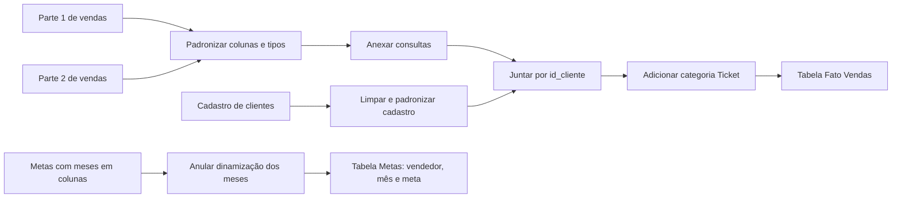
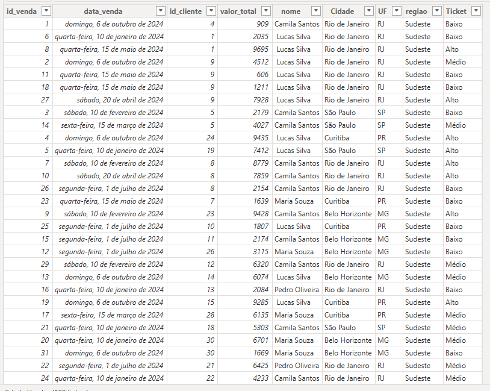
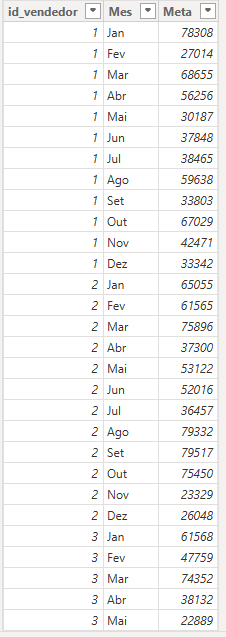

# ETL[README.md](https://github.com/user-attachments/files/33465451/README.md)
# Desafio Técnico de ETL com Power Query — Power BI

Documentação da resolução de um desafio de ETL realizado durante a formação na **Educadados**, usando o **Power Query no Power BI**.

O objetivo foi transformar bases de origem separadas em duas tabelas organizadas para análise: uma tabela de vendas enriquecida com informações de clientes e uma tabela de metas em formato tabular, com uma linha por vendedor e mês.

## O que era para ser feito

O desafio pedia consolidar e preparar os dados para que pudessem ser analisados no Power BI:

1. Unificar os lotes de vendas em uma tabela contínua.
2. Corrigir e padronizar os dados cadastrais dos clientes.
3. Relacionar vendas e clientes usando `id_cliente`.
4. Criar uma categoria de ticket para cada venda com base em `valor_total`.
5. Converter a tabela de metas, originalmente organizada com os meses em colunas, para um formato analítico com os meses em linhas.

## Como o ETL foi organizado

ETL significa **Extração, Transformação e Carga**. Neste trabalho, as fontes foram preparadas no Power Query, transformadas em consultas reutilizáveis e carregadas no modelo do Power BI.

### 1. Preparação e consolidação das vendas

- **Padronização do esquema:** alinhar os nomes e a estrutura das colunas das bases `Parte1` e `Parte2`, para que pudessem ser combinadas.
- **Tratamento de datas:** normalizar os formatos mistos de `data_venda` e verificar a consistência dos valores temporais.
- **Anexar consultas (Append):** empilhar os registros dos dois lotes em uma única consulta de vendas.

### 2. Limpeza do cadastro de clientes

- Remover espaços extras dos campos de texto com `Text.Trim`.
- Padronizar o uso de maiúsculas e minúsculas.
- Corrigir inconsistências de escrita nos nomes das regiões.
- Dividir `cidade_estado` pelo delimitador para obter cidade e estado em campos separados.

### 3. Enriquecimento e regra de negócio

- **Mesclar consultas (Merge):** relacionar Vendas e Clientes pela chave `id_cliente` e expandir os campos cadastrais necessários.
- **Coluna condicional `Ticket`:** classificar cada venda em `Alto`, `Médio` ou `Baixo`, usando `valor_total` conforme a regra do desafio.

Os limites numéricos entre as faixas não foram informados nos materiais recebidos e, por isso, não são presumidos nesta documentação.

### 4. Normalização das metas

A tabela de metas originalmente tinha uma coluna para cada mês. Foi aplicada a operação **Anular dinamização de colunas (Unpivot)** para transformar esses meses em registros. As colunas resultantes foram padronizadas como `Mes` e `Meta`, mantendo também o identificador do vendedor.

## Resultado final

### Tabela Fato Vendas

A captura abaixo mostra a estrutura final apresentada para vendas, após a junção com os dados de clientes e a criação da categoria de ticket.

Colunas visíveis na tabela final:

| Coluna | Conteúdo |
| --- | --- |
| `id_venda` | Identificador da venda |
| `data_venda` | Data da venda |
| `id_cliente` | Identificador usado para relacionar a venda ao cliente |
| `valor_total` | Valor total da venda |
| `nome` | Nome do cliente |
| `Cidade` | Cidade do cliente |
| `UF` | Unidade federativa do cliente |
| `regiao` | Região do cliente |
| `Ticket` | Faixa de valor: `Alto`, `Médio` ou `Baixo` |

### Tabela Metas

A captura abaixo mostra as metas depois da transformação para o formato longo: cada linha representa um vendedor em um mês.

Colunas visíveis na tabela final:

| Coluna | Conteúdo |
| --- | --- |
| `id_vendedor` | Identificador do vendedor |
| `Mes` | Mês da meta |
| `Meta` | Valor da meta correspondente ao vendedor e ao mês |

## Por que essas transformações ajudam

- A consolidação das vendas evita análises separadas por lote ou período de origem.
- A limpeza e a padronização tornam os campos cadastrais mais consistentes para filtros e agrupamentos.
- A mesclagem permite analisar vendas por cliente, cidade, UF e região.
- A coluna `Ticket` facilita segmentar vendas por faixa de valor.
- A tabela de metas em formato longo facilita comparar meta e resultado por vendedor e mês, além de funcionar melhor com filtros e relacionamentos do modelo.

## Ferramentas e conceitos

- Power BI
- Power Query
- Linguagem M
- ETL
- Append e Merge
- Limpeza e tipagem de dados
- Colunas condicionais
- Unpivot / Anular dinamização
- Preparação de tabelas para análise dimensional

## Materiais

- `README.md`: descrição do desafio, do processo e das tabelas finais.
- `imagens/tabela-vendas-final.png`: captura da tabela final de vendas.
- `imagens/tabela-metas-final.png`: captura da tabela final de metas.

O `.pbix` com as consultas do Power Query e o PDF `Qual_Era_O_Desafio.pdf` poderão ser adicionados quando estiverem disponíveis.
